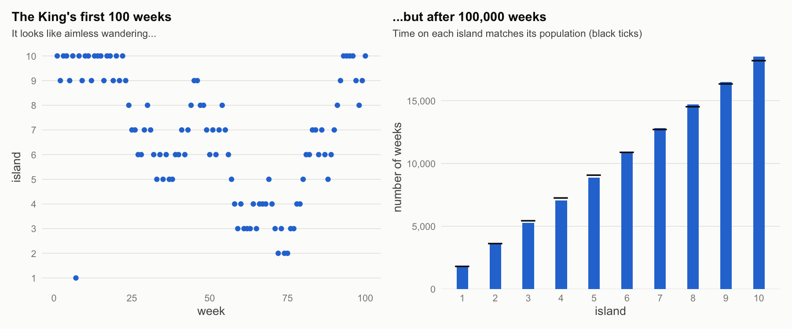
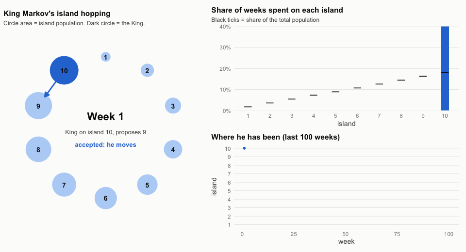
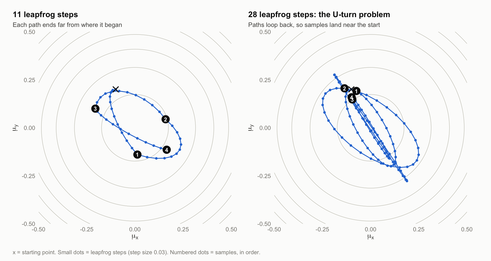
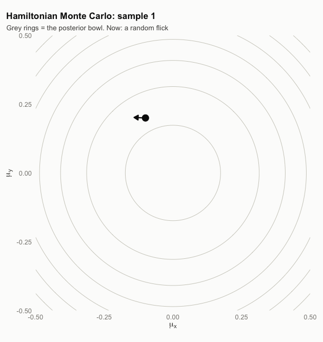

# Markov-Chain-Monte-Carlo

Simulations of two Markov chain Monte Carlo algorithms, following chapter 9 of
Richard McElreath's *Statistical Rethinking* (2nd edition) and the accompanying
[lecture](https://www.youtube.com/watch?v=Qqz5AJjyugM&list=PLDcUM9US4XdMROZ57-OIRtIK0aOynbgZN&index=9):

| Script | Algorithm | Outputs |
|---|---|---|
| `king_markov.R` | Metropolis (King Markov's island hopping) | `figures/king_markov_figure.png`, `figures/king_markov.gif` |
| `hamiltonian_monte_carlo.R` | Hamiltonian Monte Carlo on a 2D Gaussian | `figures/hmc_figure.png`, `figures/hmc.gif` |

## Running it

The project uses [renv](https://rstudio.github.io/renv/) (R 4.2.2; packages
`ggplot2`, `patchwork`, `gifski`).

```sh
Rscript -e 'renv::restore()'        # first time only
Rscript king_markov.R               # about 45 seconds
Rscript hamiltonian_monte_carlo.R   # about 40 seconds
```

Both scripts set a seed, so they reproduce the figures below exactly.

## Why MCMC at all

A posterior distribution is usually known only up to a constant: we can compute
prior × likelihood for any parameter value, but not the normalising integral
that turns it into a probability. MCMC sidesteps the integral. It builds a
random walk through parameter space that, in the long run, visits each value in
proportion to its posterior probability. The visited values are then samples
from the posterior, and any summary (mean, interval, ...) is computed from them.

Both algorithms here need only *ratios* of posterior probabilities, so the
unknown constant cancels.

## 1. Metropolis: King Markov

### Theory

King Markov rules ten islands arranged in a ring. Island $i$ has a population
proportional to $i$. He must visit each island in proportion to its population,
but he will not keep a schedule. Each week he:

1. Flips a coin to pick the island to his left or right. This is the **proposal**.
2. Compares populations. If the proposal is larger, he always moves. If it is
   smaller, he moves with probability

$$P(\text{move}) = \frac{\text{population of proposal}}{\text{population of current}}$$

3. Otherwise he stays where he is for another week. **Staying counts as a visit.**

In general terms: the islands are parameter values, the populations are
posterior probabilities, and the weeks are samples. With a symmetric proposal
(left and right equally likely), the acceptance probability is
$\min(1,\ p_\text{proposal} / p_\text{current})$.

It works because the rule balances traffic between every pair of neighbours.
If the King is on island $i$ a fraction $\pi_i$ of the time, the rate of
journeys from $i$ to $j$ is

$$\pi_i \cdot \tfrac{1}{2} \cdot \min\left(1, \tfrac{\pi_j}{\pi_i}\right) = \tfrac{1}{2}\min(\pi_i, \pi_j)$$

which is the same in both directions. So once his time is split in proportion
to population, it stays that way (this is called *detailed balance*).

### Reading the graph



- **Left, the first 100 weeks.** Each dot is the island he is on that week. Runs
  of dots on one row are weeks where the proposal was rejected. Over a short
  stretch the path looks aimless, and it is nowhere near proportional: he has
  barely touched islands 1 and 2.
- The islands form a ring, so 10 and 1 are neighbours. A jump between the top
  and bottom rows is a single step, not a leap.
- Each dot is close to the one before it. Consecutive samples are strongly
  **autocorrelated**, which is the main weakness of Metropolis: it takes many
  weeks to explore the whole archipelago.
- **Right, after 100,000 weeks.** The bars count weeks spent on each island. The
  black ticks mark where the bars *should* reach if visits were exactly
  proportional to population ($i/55$ of the weeks). They match. Nobody told the
  King the totals; the local rule alone produced the right distribution.

### Reading the animation



- **Ring (left).** Circle area is population. The dark circle is the King. The
  arrow points at this week's proposal: solid blue means accepted, dashed
  orange means rejected, with the acceptance probability shown. Moves to a
  larger island are never rejected.
- **Bars (top right).** Share of weeks spent on each island so far, against the
  black population ticks. Early on the bars are badly wrong (and run off the
  top of the axis), because he has only seen a few islands.
- **Trace (bottom right).** His position over the last 100 weeks.
- The first 60 weeks play one per frame. After that the clock accelerates to
  week 5,000 so the bars can be seen settling onto the ticks. They still wobble
  at the end; convergence is slow because of the autocorrelation.

## 2. Hamiltonian Monte Carlo

### Theory

Metropolis proposes blindly, so most of its effort goes into small steps and
rejections. HMC uses the *shape* of the posterior to make long, purposeful
moves that are almost always accepted.

Picture the posterior turned upside down into a frictionless bowl. The height
of the bowl at position $q$ (the parameter values) is the negative
log-posterior:

$$U(q) = -\log p(q \mid \text{data})$$

The most probable values are at the bottom. To draw one sample:

1. **Flick.** Give a particle at the current position a random momentum
   $p \sim \text{Normal}(0, 1)$ in each dimension.
2. **Glide.** Let it roll across the bowl following Hamilton's equations, where
   the gradient of $U$ acts as gravity:

$$\frac{dq}{dt} = p \qquad \frac{dp}{dt} = -\nabla U(q)$$

3. **Stop.** After a fixed time, wherever it is becomes the proposal.

The computer cannot follow the smooth path exactly, so it uses the **leapfrog**
integrator: $L$ small steps of size $\epsilon$, alternating updates to momentum
and position (with half steps of momentum at the start and end).

The total energy $H = U(q) + \tfrac{1}{2}p^2$ would be conserved on the exact
path. Leapfrog makes small errors, so the proposal is accepted with probability

$$\min\left(1,\ \exp(H_\text{start} - H_\text{end})\right)$$

When the step size is small enough, energy is nearly conserved and almost every
proposal is accepted, even though it lands far away.

**The cost** is that HMC needs the gradient of the log-posterior (so parameters
must be continuous) and two tuning choices, $\epsilon$ and $L$. If the total
path length $\epsilon L$ is badly chosen, the particle swings round and comes
back to where it started: the **U-turn problem**. Stan solves both
automatically: it tunes $\epsilon$ during warmup, and the No-U-Turn Sampler
(NUTS) picks the path length for each sample.

**The model here** is the book's: 50 values each of $x$ and $y$, both
standardised, with

$$x_i \sim \text{Normal}(\mu_x, 1) \qquad y_i \sim \text{Normal}(\mu_y, 1) \qquad \mu_x, \mu_y \sim \text{Normal}(0, 1)$$

The posterior for $(\mu_x, \mu_y)$ is a round Gaussian centred on zero with
standard deviation $1/\sqrt{51} \approx 0.14$.

### Reading the graph



- The **grey rings** are contours of the bowl (lines of equal $U$). The centre
  is the bottom, the most probable values.
- The **black cross** is the starting point. Each **blue curve** is one
  trajectory; the small dots along it are the individual leapfrog steps
  ($\epsilon = 0.03$). The **numbered black dots** are the resulting samples,
  in order, and each one is the start of the next trajectory.
- Paths curve because the bowl pulls the particle towards the centre. Dots are
  further apart where it is moving fast (near the bottom) and closer together
  where it has climbed and slowed.
- **Left, $L = 11$.** Each sample lands in a quite different part of the
  posterior from the one before. Successive samples are nearly independent,
  which is what makes HMC efficient.
- **Right, $L = 28$.** Same start, same step size, but every trajectory loops
  round and ends almost where it began. All that computation produces samples
  that barely move. In this bowl the particle is a pendulum with period
  $2\pi/\sqrt{51} \approx 0.88$, and $28 \times 0.03 = 0.84$ is almost exactly
  one full swing. With $L = 11$ the path covers about three eighths of a swing.

### Reading the animation



- **First 20 samples, step by step.** The black arrow is the random flick:
  its direction and length are the initial momentum. The black dot then glides
  one leapfrog step per frame, leaving a blue trail. Where it stops becomes a
  pale blue sample, and the next flick starts from there. Earlier paths fade to
  grey.
- Notice that every flick is in a fresh random direction, unrelated to the
  slope. The bowl does the steering.
- An orange dot at the end of a path would mean a rejected proposal (the
  particle returns to its start). With this step size it essentially never
  happens.
- **Then up to 1,000 samples.** The paths are dropped and only samples are
  drawn. They pile up densely in the centre and thin out towards the outer
  rings, tracing the posterior. Compare the pace with King Markov, who needed
  thousands of weeks to settle on just ten islands.

## Metropolis vs HMC in one table

| | Metropolis | Hamiltonian Monte Carlo |
|---|---|---|
| Proposal | Random nearby jump | End of a simulated physical path |
| Uses the gradient | No | Yes |
| Acceptance rate | Often low | Close to 1 |
| Consecutive samples | Highly correlated | Nearly independent |
| Parameters | Any, including discrete | Continuous only |
| Tuning | Proposal width | Step size and path length (automated by NUTS) |

## Reference

McElreath, R. (2020). *Statistical Rethinking: A Bayesian Course with Examples
in R and Stan* (2nd ed.), chapter 9. The code follows R code 9.1 (Metropolis,
section 9.1) and the `HMC2` example in section 9.3.
